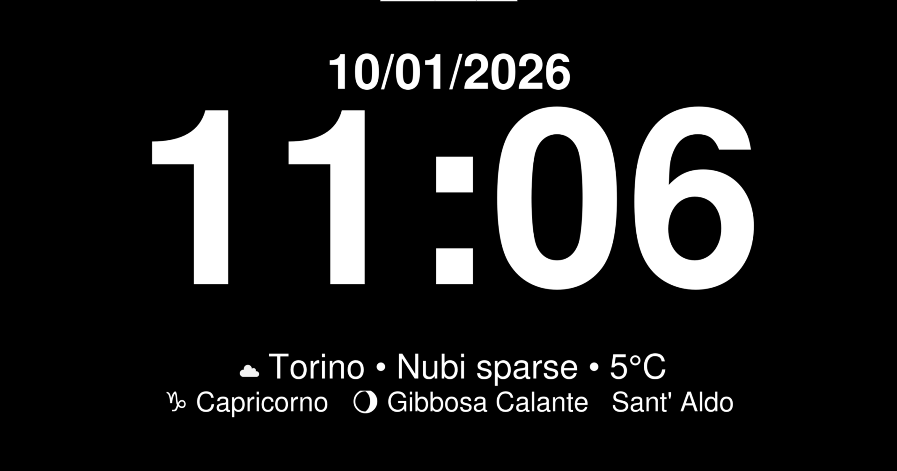

# Raspberry Pi Clock & Weather

A fullscreen weather and clock display for Raspberry Pi using Tkinter and OpenWeatherMap.



---

## Features
- Fullscreen digital clock with date  
- Real-time weather data and icon  
- Dynamic color transitions (day/night)  
- Smooth color fade effects  
- Automatic night mode (22:30–07:30)

---

## Requirements
Install required dependencies:
```bash
sudo apt update
sudo apt install -y python3 python3-requests python3-tk git
```

The requirements differ between Raspberry Pi OS Bookworm (HDMI, first test) and
Bullseye (Pi Zero 2 W with a 3.5" SPI display): see [docs/REQUIREMENTS.md](docs/REQUIREMENTS.md).

---

## Installation

Clone the repository
```bash
git clone https://github.com/InitialDeu/raspberrypiclockweather.git
cd raspberrypiclockweather
```
Configure your city and API key
Edit the script to set your location and OpenWeatherMap key:

```bash
nano display_clock_weather.py
```

Recommended: put them in an environment file read by the systemd service,
so the key never ends up in the script or in git:

```bash
echo 'OWM_API_KEY=YourOpenWeatherAPIKey' | sudo tee /etc/clockweather.env
echo 'CW_CITY=YourCity' | sudo tee -a /etc/clockweather.env
echo 'CW_LANG=en' | sudo tee -a /etc/clockweather.env     # optional: "it" for the Italian version
sudo chmod 600 /etc/clockweather.env
```

**Night mode:** from 22:30 to 07:30 the text fades to a dim amber. Optional settings in
`/etc/clockweather.env`: `CW_NIGHT_FG=#5C3300` (lower = darker), `CW_NIGHT_START=22:30`,
`CW_NIGHT_END=07:30`, `CW_NIGHT=off` to disable.

**Language (optional):** `CW_LANG=it` switches the display to Italian
(zodiac sign, moon phase, saint of the day, `dd/mm/yyyy` date and the weather description),
like the preview above. Default is English.

Alternatively, change the defaults directly in the script:

```python
CITY = os.environ.get("CW_CITY", "YourCity")
API_KEY = os.environ.get("OWM_API_KEY", "YourOpenWeatherAPIKey")
```
You can get a free API key here: https://openweathermap.org/api

Run manually (test)
```bash
python3 display_clock_weather.py
```

If everything is correct, you’ll see the fullscreen clock and weather on your display.
The layout adapts automatically to the screen resolution and orientation
(tested at 480x320, 320x480 and 1920x1080).

Using a 3.5" SPI touchscreen (ILI9486, "3.5inch RPi Display")? See [docs/OTTIMIZZAZIONI.md](docs/OTTIMIZZAZIONI.md)
for the display setup.

Autostart on boot (systemd)
To automatically start the display after boot, use the included service file.

Create or edit:

```bash
sudo nano /etc/systemd/system/clockweather.service
```

Paste this:
```ini
[Unit]
Description=Raspberry Pi Clock & Weather
After=graphical.target network-online.target
Wants=network-online.target

[Service]
Type=simple
User=pi
WorkingDirectory=/opt/raspberrypiclockweather
ExecStart=/usr/bin/python3 /opt/raspberrypiclockweather/display_clock_weather.py
Restart=always
RestartSec=10
Environment=DISPLAY=:0
Environment=XAUTHORITY=/home/pi/.Xauthority
EnvironmentFile=-/etc/clockweather.env

[Install]
WantedBy=graphical.target
```
Create the log file (the service runs as `pi`, which cannot create files in `/var/log`;
if you skip this, the script falls back to `~/clockweather.log`):

```bash
sudo touch /var/log/clockweather.log
sudo chown pi:pi /var/log/clockweather.log
```

Then enable it:

```bash
sudo systemctl daemon-reload
sudo systemctl enable --now clockweather
```

Check status:

```bash
sudo systemctl status clockweather
```

To stop or restart:

```bash
sudo systemctl stop clockweather
sudo systemctl restart clockweather
```
---

## Quick Install (One Command)

You can automate everything (install, clone, setup, and service) with the script below.

Copy and paste it directly into your terminal on your Raspberry Pi.

```bash
#!/bin/bash
# Raspberry Pi Clock & Weather - Quick Installer
# Author: InitialDeu
# License: GPL

set -e

INSTALL_DIR="/opt/raspberrypiclockweather"
SERVICE_NAME="clockweather.service"

echo "Installing Raspberry Pi Clock & Weather..."
sudo apt update -y
sudo apt install -y python3 python3-requests python3-tk git

if [ ! -d "$INSTALL_DIR" ]; then
    sudo git clone https://github.com/InitialDeu/raspberrypiclockweather.git "$INSTALL_DIR"
else
    echo "Repository already exists, updating..."
    cd "$INSTALL_DIR" && sudo git pull
fi

echo "Installing systemd service..."
sudo bash -c "cat > /etc/systemd/system/$SERVICE_NAME" <<'EOF'
[Unit]
Description=Raspberry Pi Clock & Weather
After=graphical.target network-online.target
Wants=network-online.target

[Service]
Type=simple
User=pi
WorkingDirectory=/opt/raspberrypiclockweather
ExecStart=/usr/bin/python3 /opt/raspberrypiclockweather/display_clock_weather.py
Restart=always
RestartSec=10
Environment=DISPLAY=:0
Environment=XAUTHORITY=/home/pi/.Xauthority
EnvironmentFile=-/etc/clockweather.env

[Install]
WantedBy=graphical.target
EOF

sudo touch /var/log/clockweather.log
sudo chown pi:pi /var/log/clockweather.log

sudo systemctl daemon-reload
sudo systemctl enable --now clockweather

echo ""
echo "Installation complete!"
echo "Use 'sudo systemctl status clockweather' to check status."
echo "Use 'journalctl -u clockweather -f' to view logs."
```

Make it executable (if saved separately):

```bash
chmod +x quick-install.sh
```
Run it:

```bash
./quick-install.sh
```
---

## Logging

If you want to store the logs and enable the logrotate, you can create a logrotate file:
```bash
/var/log/clockweather.log {
    daily
    missingok
    notifempty
    copytruncate
    dateext
    maxage 1
    rotate 0
}
```

And Force it using:

```bash
sudo logrotate -f /etc/logrotate.d/clockweather
```

## Updates

V1.0.1 Added Zodiac Sign, Moon Phases and Saint of the Day

V1.1.0 Auto-fit layout for any resolution/orientation, non-blocking network updates,
weather errors no longer crash the app, clock synced to the minute, Pillow no longer required,
optional Italian version (`CW_LANG=it`)

V1.2.0 Night mode back (darker, configurable), watchdog that restarts the app if updates get stuck,
stale weather/saint no longer shown as current
(details in [docs/OTTIMIZZAZIONI.md](docs/OTTIMIZZAZIONI.md))

## Notes
Tested on Raspberry Pi OS (Bookworm) with X11 desktop session using a Raspberry PI 4

Works with HDMI displays and with 3.5" SPI displays (fbtft framebuffer, tested on Pi Zero 2 W / Bullseye)

Requires active internet connection for weather updates

Screen automatically dims between 22:30 and 07:30

---

## Author
Developed by InitialDeu
Feel free to fork, improve, and contribute.

## License
This project is released under the GPL License.
